# SmartCityX — CLI Demo & Presentation Walkthrough

> **Review-1 & Viva Evaluation Walkthrough**  
> Follow this exact step-by-step terminal demonstration sequence during your project review.

---

## 🟢 Step 0: How to Launch
1. Open folder: `C:\SmartCityX`
2. **Double-click `start.bat`** (or `run.bat`).
3. The interactive SmartCityX CLI opens immediately!

---

## 💻 Step-by-Step Terminal Demonstration

```mermaid
flowchart TD
    M["SmartCityX Main Menu"]
    M --> O1["Option 1: 🏙️ Urban Overview\n(Citizen Reports & Infrastructure Assets)"]
    M --> O2["Option 2: 🔍 String Search & Triage\n(KMP, Bittu's Algorithm & Aho-Corasick)"]
    M --> O3["Option 3: 📑 Suffix Structures\n(SA-IS Linear Indexing & Kasai LCP)"]
    M --> O4["Option 4: 📐 Advanced DP\n(ASCII 2D Matrix Grid & Bitmask TSP Tour)"]
    M --> O5["Option 5: 🌊 Utility Network Flow\n(Edmonds-Karp & Bottleneck Cut Isolation)"]
    M --> O6["Option 6: 🧩 NP-Completeness\n(3-SAT, Karp Reductions & 2-Approx Cover)"]
    M --> O7["Option 7: ⚡ IoT Streaming\n(Reservoir Sampling & Blelloch Scan)"]
    M --> O8["Option 8: 📊 Verification Suite\n(Full 17-Algorithm Big-O Telemetry Table)"]
    M --> O9["Option 9: ⚔️ Benchmark Showdown\n(Direct String Matching Tournament)"]
    M --> O10["Option 10: 🎓 Viva Cheatsheet\n(Model Answers to Examiner Trap Questions)"]
```

---

### 1️⃣ Option [1]: Urban Overview
* **Type `1` and press Enter**:
* **Output:**
  - Displays summary statistics (100 citizen reports, 30 infrastructure assets, 500 IoT feeds, 20 emergency crews).
  - Prints formatted tabular ledger of recent high-priority emergencies (Fire, Gas Leak, Water Burst, Grid Failure).
* **What to say to the Professor:**
  > *"This is the urban operations ledger. It integrates municipal complaints, infrastructure health, and streaming IoT sensor feeds using custom zero-java.util collections."*

---

### 2️⃣ Option [2]: String Pattern Search & Emergency Triage (M1 & M2)
* **Type `2` and press Enter**:
* **Input:** Type `WATER` (or press Enter for default).
* **Output:**
  - **KMP Matcher:** Computes $\pi$ array and searches text in $\mathcal{O}(N + M)$ without backtracking pointer $i$.
  - **Bittu's Algorithm (Invention):** Searches in a $65,536$-dimensional bigram state space with $O(1)$ dynamic rolling vector algebra and zero heap allocation.
  - **Aho-Corasick Automaton:** Multi-keyword emergency triage across all incoming reports.
* **What to say to the Professor:**
  > *"Module 1 implements linear string matchers (KMP, Z-Alg, Rabin-Karp) plus our invention, **Bittu's Algorithm**, which achieves $O(1)$ rolling bigram cosine vector updates on primitive arrays."*

---

### 3️⃣ Option [3]: Suffix Array & SA-IS Document Intelligence (M2)
* **Type `3` and press Enter**:
* **Output:**
  - Runs **SA-IS** to build the Suffix Array in strictly linear $\mathcal{O}(N)$ time.
  - Runs **Kasai's LCP** to identify the longest repeated regulatory clauses.
  - Runs **Suffix Automaton (SAM)** to count distinct substrings in linear time.
* **What to say to the Professor:**
  > *"Module 2 indexes city operational documents and bylaws. SA-IS builds the suffix array in linear $O(N)$ time, and Kasai's algorithm finds duplicate complaint clauses via the $LCP[Rank[i+1]] \ge LCP[Rank[i]] - 1$ invariant."*

---

### 4️⃣ Option [4]: 2D Dynamic Programming (Matrix Grid & Bitmask TSP) (M3)
* **Type `4` and press Enter**:
* **Input:** Press Enter to test `WATR_BURST` vs `WATER_BURST`.
* **Output:**
  - Prints the complete **ASCII 2D DP Cost Matrix** with highlighted `[brackets]` marking the optimal backtrace path from $(N, M)$ to $(0,0)$.
  - Lists the reconstructed alignment steps (`MATCH 'W'`, `INSERT 'E'`, `MATCH 'R'`).
  - Solves the **Emergency Vehicle Patrol Tour (Bitmask DP)** visiting all disaster sectors in optimal order in $O(2^N \cdot N^2)$.
* **What to say to the Professor:**
  > *"Module 3 corrects misspelled citizen queries using Levenshtein DP with full 2D matrix backtrace reconstruction, and solves emergency dispatch routing using Bitmask DP in $O(2^N \cdot N^2)$."*

---

### 5️⃣ Option [5]: Utility Grid Max-Flow & Bottleneck Min-Cut (M4)
* **Type `5` and press Enter**:
* **Output:**
  - Computes electrical/water grid max flow using **Edmonds-Karp** ($\mathcal{O}(VE^2)$) and **Dinic's Algorithm** ($\mathcal{O}(V^2E)$).
  - Applies the **Max-Flow Min-Cut Theorem** ($\max \text{flow} = \min \text{cut}$) to isolate critical bottleneck cut edges.
* **What to say to the Professor:**
  > *"Module 4 calculates utility transmission capacity and extracts critical bottleneck cut edges whose disruption would disconnect the city."*

---

### 6️⃣ Option [6]: NP-Completeness & Sensor Surveillance (M5)
* **Type `6` and press Enter**:
* **Output:**
  - Runs **DPLL 3-SAT Solver** with Unit Propagation to satisfy zoning constraints.
  - Prints the **Karp Polynomial Reduction Chain**: $3\text{-SAT} \le_p \text{CLIQUE} \le_p \text{INDEPENDENT-SET} \le_p \text{VERTEX-COVER}$.
  - Runs **Vertex Cover 2-Approximation (Maximal Matching)** to select surveillance sensor locations with guarantee $|C| \le 2 \cdot |C^*|$.
* **What to say to the Professor:**
  > *"Module 5 models NP-complete planning using DPLL 3-SAT, verifies the formal Karp reduction chain, and uses a polynomial-time 2-approximation algorithm for sensor placement."*

---

### 7️⃣ Option [7]: IoT Streaming & Parallel Algorithms (M6)
* **Type `7` and press Enter**:
* **Output:**
  - **Reservoir Sampling (Algorithm R):** Unbiased uniform sampling of $k=5$ readings from an unbounded sensor stream ($P = k/N$).
  - **Blelloch Parallel Prefix Scan:** Work-efficient Up-Sweep and Down-Sweep prefix sums.
  - **Brent's Theorem Speedup Table:** Theoretical execution time $T_p \le \frac{W-D}{p} + D$ across 1, 2, 4, 8, 16, 32, and 64 cores.
* **What to say to the Professor:**
  > *"Module 6 processes high-speed sensor streams with Reservoir Sampling ($O(k)$ space), Blelloch's Parallel Scan ($O(N)$ work, $O(\log N)$ span), and evaluates multicore speedup using Brent's Theorem."*

---

### 8️⃣ Option [8]: Verification Suite (Full 17-Algorithm Telemetry Table)
* **Type `8` and press Enter**:
* **Output:**
  - Executes unit tests across all 17 algorithms and prints the complete Big-O table with live microsecond execution times ($\mu\text{s}$).

---

### 9️⃣ Option [9]: Benchmark Showdown Arena
* **Type `9` and press Enter**:
* **Output:**
  - Runs a live tournament comparing KMP, Rabin-Karp, Z-Algorithm, Bittu's Algorithm, and Aho-Corasick side-by-side with microsecond timing.

---

### 🔟 Option [10]: Viva Defense Cheatsheet
* **Type `10` and press Enter**:
* **Output:**
  - Prints ready-to-read model answers to the top tricky examiner questions.
